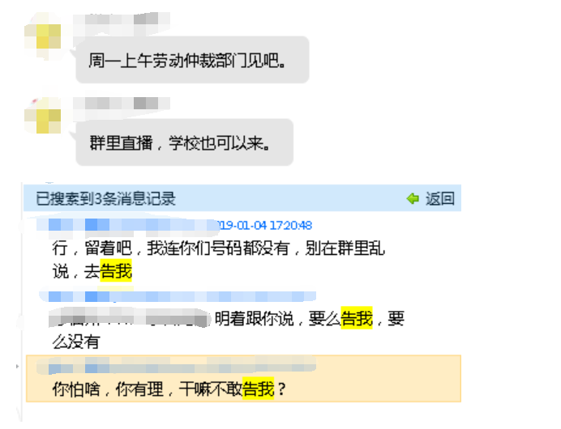

本文作者：[wangwenhai] # 概要：毕业后的第一课——我从一家烂公司里学到的东西。
<!-- more -->

> 写在前面：这不是一篇泄愤的文字，而是我走出校门后上的第一课。多年以后回头看，那些荒唐、屈辱和恐惧，最后都长进了我的骨头里。把它写下来，一是给自己留个记号，二是希望后来的人能少走一段弯路。

## 一、初出茅庐

2018年8月27日，我入职了那家公司。那时候我刚毕业，对"社会"这两个字还抱着一层温和的想象——总觉得只要肯干、肯学，就总有人看得见。如今想来，那不过是学生气的天真。我到11月19日离职，前后不到三个月，却像是熬了许久。

## 二、一屋子荒唐的人

先说那位"技术主管"。他是那种把吹牛当饭吃的人：号称三天精通C++，网吧里一小时能写个编译器，一秒钟五行代码；在他嘴里，阿里巴巴是垃圾公司，科大讯飞是垃圾公司，Java是垃圾，C++也是垃圾，唯独只有连他自己都不会写的Kotlin天下无敌。他还说360花十万一个月求他上班，腾讯请他去写代码他都不去。后来才知道，他连高中都没读完，简历上那份文凭，是花钱找人P的。

后来他不知从哪儿弄来一个工具包，所有依赖一股脑打包进去，足有七十多兆，硬说是他自己写的——连org.json都成了他的成果。他逼着全公司"学习"这套东西，谁不服从就拿开除威胁谁。说实话，接触过的人没有一个不觉得那是垃圾，之前带我的架构师，也被他恶心走了。

至于那位老板，来历也差不多。他原本是在电脑城里给人装机器的，后来不知怎么发了一笔横财，忽然就想开公司。于是租下办公室、招了一批人，风风火火地要做"高科技"。技术他不懂，管理他也不懂，摊子却越铺越大——大到后来，只能靠不停地招人、再不停地赶人来维持运转。

比吹牛更让人心里发凉的，是这家公司的日常：前前后后开除了三十多人。他们打着招聘的名义把人招来，收拾以前的烂尾项目，交付给客户收了钱，转脸就把人赶走，一分补偿都没有。去大学校招，offer都发了，临了通知"你们不用来了"；从培训机构招来一批人，养了几周，又像赶狗一样赶走。

## 三、我做的那个项目

那段时间我是真在干活的。公司唯一一个能上线的项目，是我做的，这一点所有同事都可以作证。九月整整一个月，我几乎没有按时回过家，加班到凌晨是常事，周末还要强制加班，没有任何补偿。

项目连需求都没有，全靠下面的人自己猜，所以做得极慢。公司负责人一句"先摸索着做"，就把人打发了。管理者骂人是家常便饭，"垃圾""傻逼"整天挂在嘴边。我干得很不痛快。

## 四、辞职

到了十一月，同事一个个被开除，我也挨了骂。我反复想过，还是决定走。11月11日我提了辞职，却被驳回——理由是我必须给公司招到接班人。可比我技术好的同事全被无故开除了，一时半会儿上哪儿招人？他们就是不许我走，晚上还打电话，说我不介绍人进来就别想走。

我按他们的要求，把资料、源代码，连同写好的几个文档，全部交了出去，移交给新来的同事阮XX（此人我至今还有联系方式，可以作证）。期间我没有做过任何对不起他们的事。11月19日，公司负责人突然来电话，说X总点头了、我可以走了，然后在钉钉上给我批了离职。只是工资没结，说是下个月——12月15号——来领，四千块。我答应了。

## 五、恐吓

进入十二月，眼看要发工资了，公司又打来电话：没人接手我的项目，要我继续帮他们做几个新需求，不然就"吊销你的毕业证""把你送进监狱""让你赔几十万""我们只手遮天"。威胁的话一句接一句。

他们还说我的代码不见了、没提交——其实是他们自己操作不当，把我的账户删了，再嫁祸到我头上。我那时还讲责任，硬是从自己的硬盘里把离职时删掉的代码恢复出来，给他们找了回去。我的代码一直用git管着，从2018年9月起每一次提交都有记录，同事和实习生都能为我作证。

我心里畏惧，就继续帮。那时我已经在新公司上了一个月班，他们仍旧一天一个电话，逼我"必须负责"。负责人说15号来领工资，到了又说16号。

16号那天我去了。负责人先给我一个下马威，说我给公司造成了损失，说领导看了我的项目大发雷霆。我问是什么损失，他说有两个需求没实现——可那本是新来的同事负责的，人早就被开除了。他说因为我的"过失"，有可能把我送进监狱，还要通知我的女朋友、老师、学校，甚至吊销我的学位证（这些都有录音为证）。最后公司"决定"，从我工资里扣2500，只发1500；负责人又说他私下给我加了500，凑成2000。我想，多一事不如少一事，两千就两千吧。可话音刚落，他又说今天领不了，过了对账期，下个月再来。我签了字，拿了离职证明和一张空头工资条，回了家。

2019年1月4日，距离辞职已经快两个月，我还是没拿到那笔工资。整个十二月，我都在想他们威胁我的那些话，天天睡不好觉。那天在一个QQ群里碰见那位负责人，我提起工资的事，他非但不给，还变本加厉地威胁，连同我的学校一起辱骂。

## 六、尘埃落定

后来，我的老师帮我申请了法律援助。他们一听说，立刻就软了：把剩下的两千补上，还赔了礼、道了歉。

原来那些凶神恶煞，不过是一层纸。

## 七、这一课

这件事我记了很多年。它教会我的，其实不是"社会很黑暗"这么简单。

它让我明白，人的尊严不是别人给的，是自己守住的。退让换不来体面，只会喂饱恶意。那些靠恐吓、靠拖延、靠欺负年轻人的人，最怕的恰恰是你把事情摆到台面上——你越怕，他越凶；你一站直，他反倒矮了下去。

我也想对刚毕业的年轻人说一句：愿你晚一点遇到这类人；万一遇到了，也别慌。守住你的证据，守住你的底线，把该做的事做完，然后头也不回地走。恶人不值得你用心情和青春去陪。

那段经历像一根刺，扎了很多年。可也正是那根刺，让我后来每到一家新公司，都先看人、再看事；让我懂得，一份工作可以普通，但共事的人不能烂。带着这一课往前走，我反而走得更稳了。

也把这些当时曝光过的信息留在这里，给后来人提个醒：

- https://www.tianyancha.com/company/3019068015
- https://www.tianyancha.com/company/672969176
- https://www.tianyancha.com/company/3161936849
