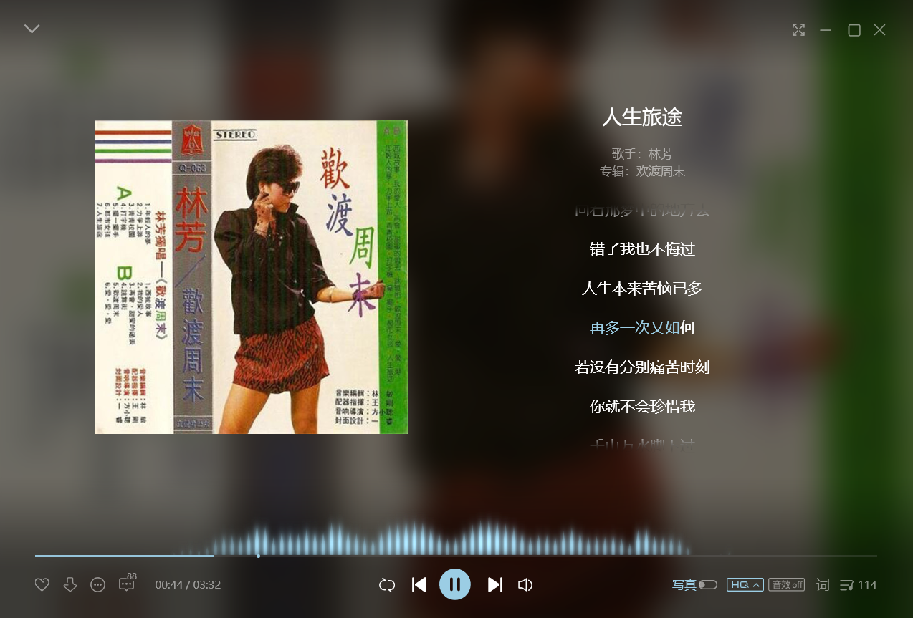

本文作者：[wangwenhai] # 概要：离开舒适地，要有危机感。
<!-- more -->

是的，2020年5月底，我离职了。放弃了舒适的环境和不错的薪水，离开这个我从来不用加班的地方。

2019年春天刚到这里时，整个院子一片安静，我心想：这应该是个很舒服的地方。果然没出我所料——接下来这一年，我过得是真的舒服。

这里是一家知名研究机构下面的孵化公司，主攻工业机器人。我负责物联网终端设备的接入和业务系统。本以为能做出点成绩，没想到却像温水里的青蛙，慢慢被煮了。

工作过于清闲，以至于领导和同事全是外行——做软件开发的几个人都不专业，甚至有没上过大学的在担任要职。匪夷所思的事经历了太多：说要自己研发操作系统、自己写Nginx、自己做一个PUB/SUB系统……这里就不一一列举了。

可这些，一件也没做成。整个研发团队属于"养老系"，技术水平连2020年毕业的应届生都比不上，每天就是开开会、做做样子，假装在工作。

但日子是真的舒服。按时上班、按时下班，一年下来没加过班，一直定着闹钟等下班：6点下班，6点02就出了大楼。工作强度几乎像公务员，不问产出、不担产品责任，压力几乎为零。

这简直是我爸妈心目中的"圣地"——"阴凉房""高工资"。可现在，我却失眠了。正是这份安逸，给了我危机感。

进入5月，我忽然发现很多东西都不会了：写个单片机固件，想不起C++的构造函数怎么写；写个SDK，连最基础的消息队列都用不利索。再看看同期进大公司的学弟，我明显在退步，随时可能被淘汰。那阵子我开始失眠、焦虑，心态也慢慢变差。我知道，是舒适的生活让我迷茫了。

于是我反复斗争，最后决定：离职，去大公司从底层干起，重新见见世面。放弃舒适的环境和优越的薪水，真的很难。可转念一想，反正本就一无所有，又何必在乎多拿那一两万？也许这两年，我真不需要太多钱吧。

如果说两年前离开厦门是一个转折点，那么这一次，也会是我的又一个转折点。

不在逆境中成长，就在顺境中煲汤。
