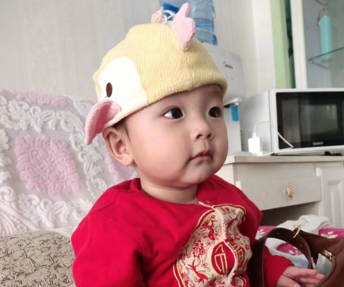
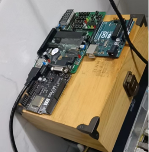
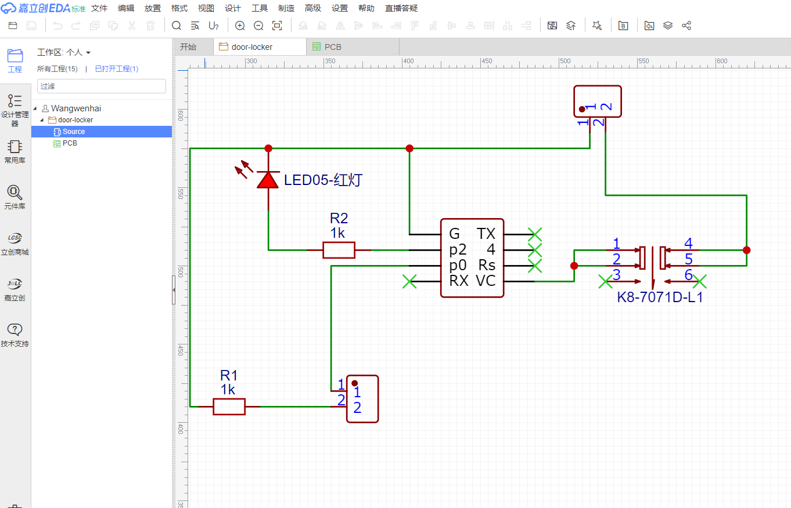

本文作者：[wangwenhai] # 概要：我的2022
<!-- more -->

# 2022总结

***2022年，是我彻底告别过去、重新开始的一年。***

如果只用一句话概括这一年，我想是：把前几年学到的东西大半放下，去把大学时丢掉的梦想重新捡起来。写下这些字时已是2023年1月11日，回头望去，分离、为人父、转行，几乎每一件都是人生里的大事。

## 一、分离
这一年，我和妻子分开了整整一年。她怀着孕，加上当时疫情闹得人心惶惶，我们都怕深圳的风险，为了安全，她留在千里之外的家里。而我整个2022年，只回去过一次。

每个人都在为将来的日子咬牙撑着。致敬我们这些不肯停下的人。

## 二、当父亲

2022年4月，我的小宝宝出生了，是个很可爱的小家伙。我给她取名"芷君"——芷是小兰花，我希望她将来能像兰花一样，清新而不落俗套。28岁这年我当了父亲，也就多了一份责任。

## 三、反思：一种危机感

从2018年毕业算起，我先做了两年Java，2020年跑去杭州做了一年Erlang，2021年7月到深圳，做了半年业务。可从2021年下半年起，心里渐渐生出一种危机感：上层那些简单的应用、框架类开发，已经趋于饱和。以前会个框架、会个数据库就很抢手，如今框架多如牛毛，打开学习网站，满屏都是"教你手写一个SpringBoot"的教程。我意识到，未来的竞争力已经不在业务端和前端了，必须想办法把自己拉回来。

## 四、转行

于是2022年过完年回来，我果断放下了CRUD和WEB开发那一套。这对谁都是个挑战，等于自废多年武功。但我下了决心，从2月起全力投入系统级开发和物联网中间件。

从CRUD转到系统级，很考验毅力：我大学虽读的是电子类专业，可四年没碰过硬件，连C语言基础都忘了，看张硬件连接图都费劲。上半年我咬牙把大学的数字电路、模拟电路翻出来重新啃，看了大半年才找回点感觉，勉强能看懂开发板的原理图。所以2022年是我拼得最狠的一年，不是在写代码，就是在下班路上；到今天（2023年1月11日），我90%的业余时间还是花在看书上。

幸运的是，转行好像成功了。大概5月，我还在公司亲自用嘉立创EDA画了块PCB，拿电烙铁焊了块ESP32开发板——画得难看，焊得更难看，但那时就是逼着自己去碰这些完全陌生的东西。

## 五、感触
想起2018年刚毕业那会儿，我们在福州找不到物联网相关的工作，很多电子信息的同学都转了行：有人去做销售，有人回了老家，我自己也转去做了业务。时光一晃，没想到当年的梦想又被捡了起来——算是回到了原点。

我常跟人说：如果当年我直接就去了深圳，今天又会怎样？

## 六、这一年的学习

这一年我学得很杂，也很拼，大致能分成几块。

**读源码、啃设计。** 系统读了LUA的源码与它的设计理念（《LUA设计与实现》），尤其把基础数据结构那部分吃透了；又试着自己用Flex、Bison写了个计算器，弄明白了简单的DSL该怎么处理。三月被隔离的31天里，读了两篇论文《Bitcask》和《Raft》，还实现了Bitcask的一个demo——Raft太复杂，看得吃力。

**往底层钻。** 我对Linux的兴趣越来越浓，长时间研究Linux开发，其间读了《C接口与实现》《Linux驱动开发》《Linux0.12源码分析》，自己动手写了几个驱动，顺带又研究了数字电路和模拟电路，Linux和嵌入式的功底扎实了不少。

**动手做东西。** 一月玩了一阵单片机。想不到大学时玩不明白，如今翻翻资料就能做出点东西，正应了那句话：基础知识是万物之本。前阵子试着搭了个基于ATMEGA328P的Task系统，最近又搭了个基于STC89C52的Task系统——完全是基础知识推着我往前走。

**在工作里落地。** 我设计了一套工业与物联网应用软件体系AIIM，从云端到中间件再到硬件终端，几乎全摸了一遍，做出了数据交互，也成功用到了工作里；又重构了RULEX框架，顺带摸索出Golang在嵌入式Linux软件开发里一条不错的实践路子——经过一年多调研、实践和落地，发现用Golang开发嵌入式软件还挺有优势。此外，我维护了一大批和Golang有关的物联网协议包，一年下来涉及的仓库竟有160多个（PR、issue等）。

一年下来，我对边缘网关的认识也更透了，如今各类工业、物联网、楼宇网关几乎张口就能开发，一套思路走遍天下。我把这套概念讲给朋友和同事听，反响都还不错——也让我越来越服气基础知识。

## 七、2023年的打算

以上就是2022年的大致经历。回想起来，这一年对自己够狠。新的一年，我给自己定了四件事：

1. 继续研究Linux开发，今年侧重高性能服务器；
2. 继续钻研操作系统的高级知识，侧重任务调度；
3. 研究新一代的网络技术、无线技术；
4. 开发一款物理硬件网关，一款DTU，一款开发板。

## 学习推荐
- 《深入理解计算机系统》（机械工业出版社），强烈推荐，不论你是做纯粹的业务类软件的，还是做嵌入式系统开发的，这本书应该作为圣经摆在右手边！
- 《深入理解Linux内核》（封面大气泡那本）
- 《Linux\Unix 系统编程》（Man7）
- 《高性能Linux服务器开发》（游双）
- 《C++并发编程》（安东尼）
- 《模拟电子基础》（童诗白）
- 《数字电路基础》（阎石）
- 《图解网络硬件》（日本那本）
- 《C语言核心技术》（封面是牛头）
- 《C接口与实现》（人民邮电出版社）
- 《C++11 Primer》（第四版）

## 不足
- 因为个人喜好，数据库、前端一直是我的盲区，2023年该了解一些了。
- 脾气还是收不住，容易发火；不过比起两年前已有进步，往后努力做个有涵养的人。

---
上面只是个大致计划，具体的看时间安排。不过说真的，我确实和一开始想走的路，渐行渐远了。
