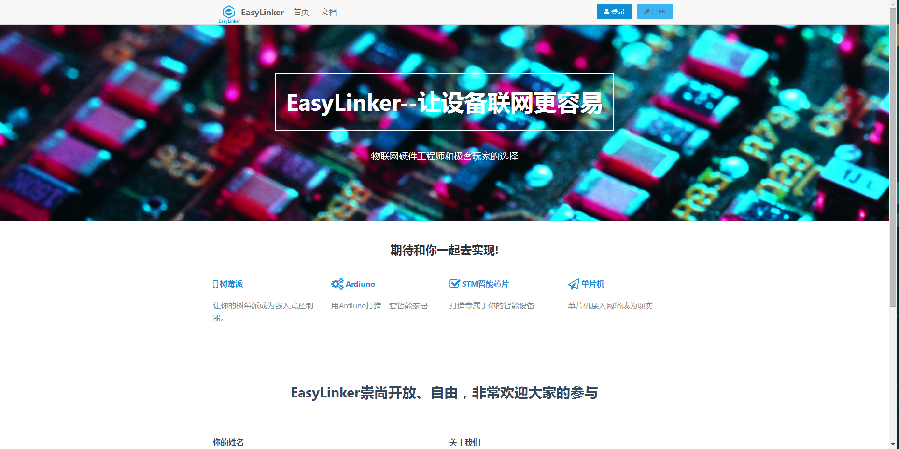
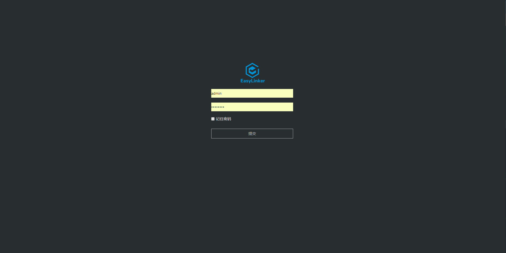
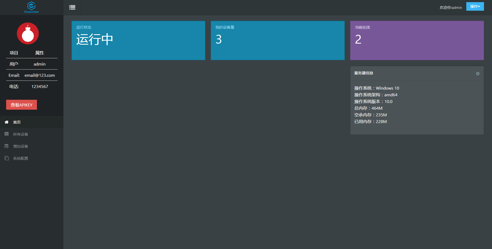
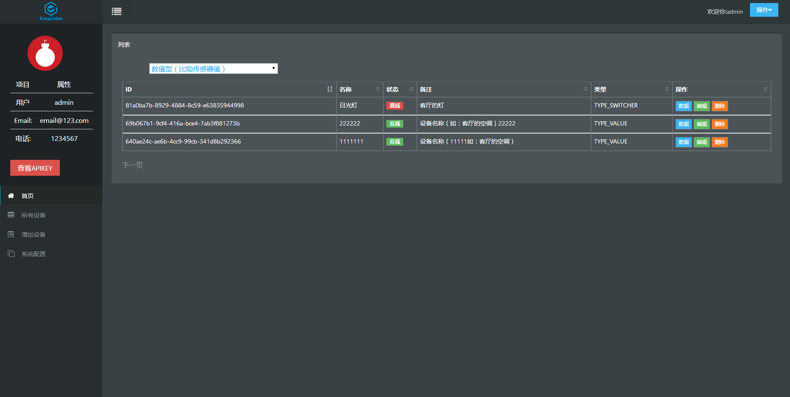
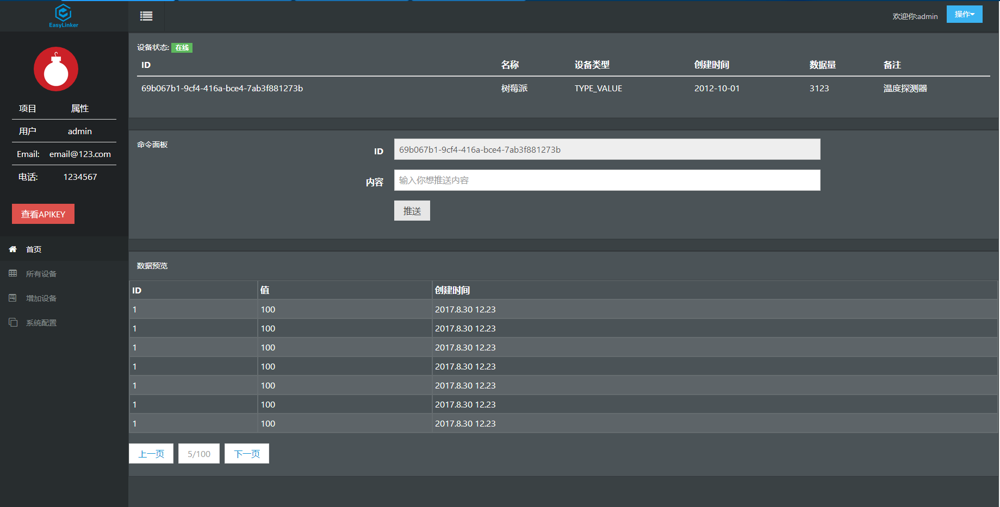

本文作者：[wangwenhai] # 概要：不小心翻出来大学的时候写的代码。
<!-- more -->

2022年3月14日，我在码云上翻出了大学时写的一段代码，一时感慨万千。

那是2017年，我才大二下学期。那时候心里揣着一个念头——做一个物联网平台，于是动手写了个demo，取名easylinker。现在想想，它大概算得上国内第一个公开的物联网平台。

当初我并不觉得这是什么了不起的事。只是身边同学的老问题总在眼前晃：单片机采到的数据，得抱着仪器才能看；想让它上网、想在手机上瞧一眼，又得从头再搭一遍。硬件和网络之间，横着一道谁都不愿意管的沟。我就想，能不能搭一个通用的平台，把这沟填上，让一切联网都容易一点。

我没想到，这么个连"半成品"都算不上的东西，后来竟一直牵着我的路走。看着当年自己写下的项目简介，对照着当初那份初衷，满满都是回忆。

## 当年的项目简介

> 本人是电子信息工程理工科男一枚，标准技术宅。本该去研究CPU架构和汇编语言的我，却迷上了WEB互联网开发；加上平时喜欢折腾极客玩具，渐渐对硬件也来了兴趣。
>
> 身处硬件相关专业，身边总围绕着各种各样的问题。比如有同学做STM32单片机时会抱怨："我要是能把拿到的数据用软件存起来就好了，到时候直接拿出来看。"还有人说："要是能把单片机的数据传到网络里就好了，可以随便查看。"这些都是硬件工程师的难处——硬件不负责数据的可视化，他们更习惯用各种仪器去看。
>
> 我便想：能不能解决这个问题？让硬件工程师随时都能查看数据，用手机、用浏览器、用APP都可以观测结果，也就是打造一个"通用的平台，让硬件把数据送到互联网上去"。
>
> 于是自己动手试。前后试了很多方法，也解决了一部分问题，却总是不完美。中间用Python在树莓派上做过一个数据呈现平台，效果不理想。折腾许久，最终决定用Java来实现它。这就是这个项目的由来，它的含义只有一句话：**让一切联网变得更加容易。**

## 当年的界面







## 一点技术细节

这个项目当年是用Springboot框架做的，前端大概是用Java的模板引擎，为了它还专门学了Activemq的二次开发。下面这个插件，就是那时候写的：

```
package com.wwh.iot.easylinker.activemqplugin;

import org.apache.activemq.broker.Broker;
import org.apache.activemq.broker.BrokerFilter;
import org.apache.activemq.broker.ProducerBrokerExchange;
import org.apache.activemq.command.ActiveMQTextMessage;
import org.apache.activemq.command.Message;

/**
 * Created by wwhai on 2017/9/1.
 */
public class AuthBroker extends BrokerFilter {

    public AuthBroker(Broker next) {
        super(next);
    }

    @Override
    public void send(ProducerBrokerExchange producerExchange, Message messageSend) throws Exception {
        ActiveMQTextMessage receivedMessage = (ActiveMQTextMessage) messageSend;
        String dest=receivedMessage.getDestination().toString();
        if (dest.equals("topic://DISCONNECTED")) {
            removeConnection(getAdminConnectionContext(), receivedMessage.getConnection().getConnectionInfo(), new Exception("error"));
            System.out.println("remove connection :"+receivedMessage.getProducerId());
        }
    }
}

```

## 后来这些年

2018年毕业以后，我辗转福州、厦门。2019年进了研究院，做工业机器人的后台，也接过人脸识别，绕了一圈，最后又绕回到物联网上——研究EMQ，啃Erlang，光是为了写个能跑起来的服务器就花了一个多月；从那年10月起，Erlang正式进了我的技术栈。

那几年我换过好几座城市：2020年去杭州，2021年到了深圳，一待就是两年，2023年又回到福州。工作换了几茬，方向也修正过几回，可"做一个物联网平台"这个念头，始终搁在心里，没有扔下。白天上班、晚上写代码玩开发板的那些日子，说到底，都是在给这个念头添砖。

## 尾声

时光过得很快，从写下这份简介到今天，已经五年了。我始终没能做出当年想要的那个物联网平台，几次离它最近的时刻，也都差了点火候。但正是它，成了我梦想的起点，支撑我一路走到现在。

说不清是庆幸还是遗憾——如果当年没有那个demo，我大概不会那么早就认准物联网，也不会在后来那些疲惫的夜里，还愿意为一个"没什么用"的念头熬下去。

但愿我们不忘初心，还能找回当初写的代码，共同纪念我们这代人那逝去的青春。

## 参考

- https://gitee.com/wwhai/easylinker
