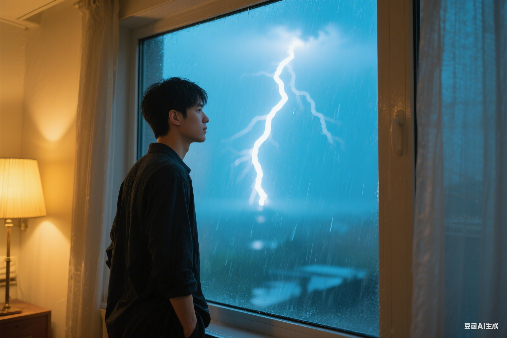

本文作者：[wangwenhai] # 概要：2025年雨夜。
<!-- more -->

今天晚上回家的时候，突然下起了雨，顷刻之间，豆大的雨滴从天而降。近期不断的有台风的新闻，这也许是台风天引发的暴雨吧。

我恰好又没有带伞，顶着暴雨奔跑了将近800米才到住所.而此时早已乌云密布，地面水流成柱。庆幸自己跑得快，又懊恼自己没带伞，而我来南方十余年，竟也没有养成带伞的习惯。但见路边的行人似乎白天也打一把伞，好像是在嘲讽我活该淋雨。

我站在窗户边，看着外面滂沱大雨，时而电闪伴随雷鸣，忽地想起，似乎很多年以前也有可能是我的孩童。或者青少年时期也有类似的场景。我的孩童时期，某一天在田地里干农活或者玩耍，突然降下暴雨而手足皆湿。也有一幕是青年时期某一次远行的时候，在火车站外瓢泼大雨中，我拿着行李箱走出站台，焦急的在寻找出口，或者在等某个人。一幕幕的遥远的事，但这又很清晰的浮现在我的眼前。同时又能想起不少雨夜相关的流行歌曲。我喜欢的华语歌手们似乎都写过和雨相关的歌。我最喜欢的是张宇的那首：《雨一直下》。

长大以后时间过得真的是飞速，很多时候总感觉似乎某个经历和某个体验是昨日之事，但是却又是三五年以前发生。我的人生像火车一样正在飞快的疾驰，有时候似乎失去了方向陷入了泥泞；有时候又穿过了一片迷雾拨云见日。

雨骤的停下来，我打开窗户，一股潮湿又闷热的空气迎面扑来。仅在这一个小时左右的时间里，经历了暴雨又平静，也恰似某个时刻的心态一般波澜起伏。

少年时代的我在农田里躲雨，青年时代的我在车里在旅途中躲雨。明天的我已经步入中年，我应该去哪里，该上哪里去躲雨？

